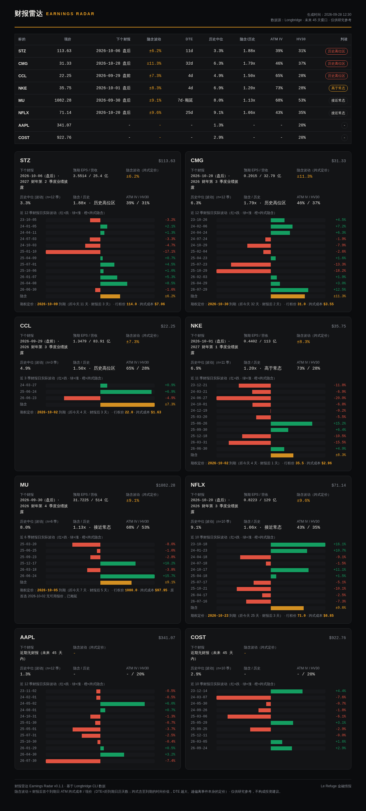

# 财报雷达 · Earnings Radar

> 输入自选股清单 → 输出「下个财报日 + 期权隐含波动 + 历史财报日波动分布」。
> 数据源：[Longbridge CLI](https://open.longbridge.com)。单文件、零第三方依赖、暗底 HTML 报告。



## 它回答什么问题

财报季最常被问的两个问题：

1. **下个财报是什么时候？**（美东日期 + 盘前/盘后 + 预期 EPS/营收）
2. **市场给这次财报定价了多少波动？** —— 用财报后首个可用到期日的 ATM 跨式成本 ÷ 现价估算「隐含波动幅度」，再和过去 12 个季度的实际财报日波动对比：**这一季的波动定价，是贵还是便宜。**

## 功能一览

- 📅 **财报日历**：未来窗口内已确认的财报日（含盘前/盘后与预期）
- 📈 **隐含波动**：ATM 跨式定价 → ±x%（最近到期无报价时自动顺延到下一个可用到期日，并标注「顺延」与 DTE）
- 🕰 **历史分布**：近 12 季财报日实际波动（红跌绿涨条形图，一眼看清历史脾气；标注样本量 n）
- ⚖️ **IV vs HV30**：ATM 隐含波动率 vs 30 日历史波动率
- 🏷 **判读标签**：隐含/历史中位比值 → 历史高位区 / 高于常态 / 接近常态 / 低于常态
- 📄 **输出**：暗底 HTML 报告（自包含、可直接分享）+ CSV（Excel 直接打开）

## 安装

```bash
# 1) Python 3.8+（只用标准库，无需 pip install）
# 2) 安装并登录 Longbridge CLI —— 见 https://open.longbridge.com
# 3) 开箱即用
python3 earnings_radar.py --tickers NKE,MU,COST
```

## 用法

```bash
# 快捷清单
python3 earnings_radar.py --tickers NKE,MU,STZ,CCL

# 从文件读取（每行一个标的，# 开头为注释）
python3 earnings_radar.py --tickers-file watchlist.txt

# 调整窗口与历史年数、指定输出
python3 earnings_radar.py --tickers AAPL --days 60 --history-years 3 --out reports/q3.html
```

| 参数 | 默认 | 说明 |
|---|---|---|
| `--tickers` | — | 逗号分隔清单（无后缀自动按美股 `.US` 处理） |
| `--tickers-file` | — | 每行一个标的 |
| `--days` | 45 | 未来窗口（只看这段时间内已确认的财报日） |
| `--history-years` | 3 | 历史统计年数 |
| `--out` / `--csv` | 自动 | 输出路径（默认 `earnings_radar_YYYYMMDD.html/.csv`） |
| `--cli` | `longbridge` | CLI 路径（或环境变量 `LONGBRIDGE_CLI`） |

## 计算口径

- **隐含波动幅度** ＝ 财报后首个可用到期日的 ATM 跨式（call + put 最新价）÷ 现价 —— 市场对该事件价格位移的近似定价。
- **DTE** ＝ 报告生成日到所用期权到期日的日历天数；**财报后** ＝ 财报日到到期日的天数。DTE 越大，跨式所含时间价值越多，越偏离「事件本身」的定价。
- **顺延** ＝ 首选到期日（财报后最近一个）无可用报价时，自动改用下一个可用到期日；报告中会显式标注。
- **历史波动** ＝ 盘后披露：财报日后首个交易日收盘 ÷ 财报日收盘 − 1；盘前披露：财报日 ÷ 前一交易日 − 1。统计取近 12 季绝对值的中位数，并标注实际样本量 n。
- **比值** ＝ 隐含波动 ÷ 历史中位绝对值 → 判读标签。
- **HV30** ＝ 近 30 日对数收益标准差 × √252。

## 局限（诚实说明）

- **两个波动不是同一个窗口**：隐含波动对应「到到期日」的窗口，实际波动是「财报日相邻交易日」的一日口径——比值存在系统性结构差异，只能当**粗参照系**，不是套利信号。
- **样本量问题**：12 季中位数仍是小样本（部分标的因财报日历数据不全，n 可能更少）；样本变化会让比值明显漂移（实测：同一标的仅把窗口从 8 季扩到 12 季，比值可从 1.3x 移到 1.9x）——请结合 n 与分布条形图一起看。
- 使用期权**最新价**（非买卖中间价），流动性较差的合约存在偏差；跨式定价是经典近似而非精确推导。
- 财报日期以 Longbridge 日历「已确认」口径为准：尚未官宣的财报不会出现（显示"窗口内无已确认财报"）。
- 美股为主；港股等市场未系统验证。
- 数据质量与延迟取决于 Longbridge CLI。

## 更新记录

- **v0.1.1**（2026-09）：按社区反馈──① 每行标注 DTE 与「顺延」标记；② 实际波动样本 8 季 → 12 季并标注 n；③ README 增补口径与局限说明。
- **v0.1.0**（2026-09）：首个公开版本。

## 免责声明

仅供学习研究，不构成任何投资建议。期权风险极高，请独立判断、自担风险。

---

## EN

**Earnings Radar** — a single-file, zero-dependency toolkit that turns a watchlist into an earnings-event dashboard: *next earnings date (BMO/AMC), options-implied move (ATM straddle after earnings ÷ spot), the last 12 quarters of realized earnings-day moves, and IV vs HV30*. Each row carries a **DTE tag** and a **fallback flag** when the nearest expiry had no quotes. Powered by [Longbridge CLI](https://open.longbridge.com). Outputs a dark-theme HTML report + CSV. Research only, not investment advice.

---
MIT License · Data by [Longbridge](https://longbridge.com) · Built by Le Refuge 金融情报
